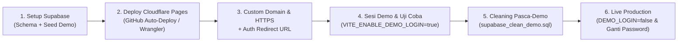

# Panduan Setup & Deploy Production (Cloudflare Pages + Supabase + Custom Domain)

Panduan lengkap untuk men-deploy **Sistem Presensi PKBM Cahaya Mulia** ke lingkungan production menggunakan **Cloudflare Pages** (frontend & CDN HTTPS), **Supabase** (Auth, PostgreSQL, Row Level Security, Realtime), dan **Custom Domain**, mulai dari **seeding demo awal** hingga **cleaning pasca-demo** saat sekolah mulai beroperasi penuh.



---

## Ringkasan Persiapan File di Repositori

- **`public/_redirects`** — Aturan SPA routing (`/* /index.html 200`) agar refresh halaman (`/siswa`, `/guru`, `/admin`) tidak 404.
- **`public/_headers`** — Header keamanan (`Permissions-Policy: camera=(self), geolocation=(self)`) untuk kamera QR & GPS serta `no-cache` untuk Service Worker PWA (`sw.js`, `manifest.webmanifest`).
- **`.env.example`** — Template environment variable frontend (`VITE_SUPABASE_URL`, `VITE_SUPABASE_ANON_KEY`, `VITE_ENABLE_DEMO_LOGIN`).
- **`supabase_schema.sql`** — Skema database production, RLS policies, trigger anti-eskalasi role, RPC operasional, dan aktivasi Supabase Realtime.
- **`supabase_seed_demo.sql`** — Data seeding demo awal (1 Root Admin, 2 Guru Piket, 33 Siswa Kelas 10/11/12, riwayat presensi bulan berjalan, 1 contoh izin).
- **`supabase_clean_demo.sql`** — Skrip cleaning pasca-demo (menghapus data & akun demo, menyisakan Root Admin `ADM-001`, master kelas, dan pengaturan GPS).

---

## Langkah 1 — Setup Supabase (Database, Keamanan & Seeding Demo)

### 1.1 Buat Project Supabase
1. Login ke [Supabase Dashboard](https://supabase.com/dashboard) -> klik **New Project**.
2. Isi nama project (contoh: `presensi-pkbm-cahaya-mulia`) dan password database yang kuat.
3. Pilih region terdekat: **Southeast Asia (Singapore)** (`ap-southeast-1`) -> klik **Create new project**.

### 1.2 Jalankan Schema Production (`supabase_schema.sql`)
1. Buka menu **SQL Editor** di sidebar kiri -> klik **New Query**.
2. Salin seluruh isi file **`supabase_schema.sql`**, tempel ke editor, lalu klik **Run**.
3. Pastikan hasil eksekusi menunjukkan `Success` tanpa error. Skrip ini aman dijalankan ulang (*idempotent*) dan menyiapkan:
   - Tabel `classes`, `profiles`, `pengaturan_sekolah`, `presensi`, dan `pengajuan_izin`.
   - Helper `get_my_role()`, trigger `trg_prevent_non_admin_profile_escalation`, dan kebijakan **Row Level Security (RLS)**.
   - RPC operasional: `get_email_by_identifier`, `submit_presensi_gps`, `scan_qr_presensi_siswa`, `submit_pengajuan_izin`, `update_rekap_signatory`, `reset_siswa_qr_token`, `admin_create_user`, `admin_update_user`, `admin_reset_user_password`, dan `admin_set_user_deleted`.
   - Publikasi **`supabase_realtime`** agar presensi dari QR/GPS langsung muncul tanpa refresh.

### 1.3 Isi Data Demo Awal (`supabase_seed_demo.sql`) — *Untuk Demo Awal*
1. Buka tab query baru di **SQL Editor**.
2. Salin seluruh isi file **`supabase_seed_demo.sql`**, tempel, lalu klik **Run**.
3. Data yang otomatis terisi:
   - Master kelas `10`, `11`, `12` dan pengaturan default PKBM Cahaya Mulia.
   - **1 Akun Root Admin**, **2 Akun Guru Piket/Tutor**, dan **33 Akun Siswa** (Kelas 12: `13` siswa, Kelas 11: `10` siswa, Kelas 10: `10` siswa).
   - Riwayat presensi bulan berjalan (Senin–Jumat hingga hari ini) + 1 pengajuan izin contoh.
   - Akun siswa demo (`ADE IZA MUKTI` / `20241201`) dibiarkan **belum absen hari ini** agar langsung bisa didemokan via GPS maupun Scan QR.

#### Daftar Akun Demo Utama (Password: `password123`)

| Role | Email | NISN / NIP / ID | Catatan |
| :--- | :--- | :--- | :--- |
| **Administrator** | `admin@pkbm.sch.id` | `ADM-001` | Akun Super Admin Root (`is_root = true`) |
| **Guru Piket 1** | `tutor@pkbm.sch.id` | `198507122010011005` | Budi Santoso, S.Pd (Kelas 10, 11, 12) |
| **Guru Piket 2** | `siti.tutor@pkbm.sch.id` | `199003152015022003` | Siti Nurhaliza, M.Pd (Kelas 11, 12) |
| **Siswa Demo** | `ade@pkbm.sch.id` | `20241201` | ADE IZA MUKTI (Kelas 12 — siap demo presensi) |

### 1.4 Ambil API Keys Supabase
1. Buka **Project Settings** -> **API** (atau **API Keys** pada tampilan dashboard terbaru).
2. Catat:
   - **Project URL** (contoh: `https://abcdefgh.supabase.co`) -> untuk `VITE_SUPABASE_URL`
   - **anon public** key / **Publishable key** -> untuk `VITE_SUPABASE_ANON_KEY`
3. **Larangan Keras:** Jangan pernah menaruh `service_role` / `secret` key di `.env` maupun di Cloudflare Pages.

### 1.5 Kunci Registrasi Publik (Direkomendasikan Saat Live)
Karena aplikasi ini tidak memiliki halaman daftar mandiri (semua akun dibuat oleh Administrator melalui Dashboard Admin):
- Buka **Authentication -> Sign In / Providers -> Auth Providers (atau User Signups)** dan nonaktifkan **Allow new users to sign up** agar tidak ada pihak luar yang dapat mendaftarkan akun secara langsung lewat API publik. Akun admin/guru/siswa yang dibuat lewat Admin Dashboard tetap berjalan normal lewat RPC server.

---

## Langkah 2 — Pilih Cara Deploy ke Cloudflare Pages

| Metode | Keunggulan | Cocok Untuk |
| :--- | :--- | :--- |
| **Cara 1: GitHub Auto-Deploy** *(Direkomendasikan)* | Zero CLI setelah setup awal, setiap `git push` otomatis build & deploy, rollback 1 klik | Operasional sekolah jangka panjang |
| **Cara 2: Wrangler CLI Direct Upload** | Build di laptop dan langsung upload `dist/` dalam hitungan detik tanpa perlu connect GitHub | Demo mendadak / upload manual cepat |

---

### Cara 1 (Direkomendasikan) — GitHub Auto-Deploy via Dashboard

1. Pastikan seluruh commit terbaru di branch `main` sudah di-push ke GitHub:
   ```bash
   git push origin main
   ```
2. Login ke [Cloudflare Dashboard](https://dash.cloudflare.com) -> **Workers & Pages** -> **Create** -> tab **Pages** -> **Connect to Git**.
3. Hubungkan akun GitHub dan pilih repository **`Wizfie/presensi-sekolah`**.
4. Isi **Build settings**:
   - **Project name:** `presensi-pkbm` *(atau nama lain -> menghasilkan `<project>.pages.dev`)*
   - **Production branch:** `main`
   - **Framework preset:** `Vite`
   - **Build command:** `npm run build`
   - **Build output directory:** `dist`
   - **Root directory:** `/` *(biarkan kosong/default)*
5. Buka **Environment variables (advanced)** -> tambahkan untuk **Production** & **Preview**:

   | Variable Name | Value | Keterangan |
   | :--- | :--- | :--- |
   | `NODE_VERSION` | `22` | Wajib `>=20.19` atau `22` (kebutuhan Vite 8) |
   | `VITE_SUPABASE_URL` | `https://xxxx.supabase.co` | Project URL Supabase Anda |
   | `VITE_SUPABASE_ANON_KEY` | `eyJhbGciOi...` | Anon / Publishable key Supabase |
   | `VITE_ENABLE_DEMO_LOGIN` | `true` *(demo)* / `false` *(live)* | Tampilkan/sembunyikan tombol *Akses Demo Cepat* |

6. Klik **Save and Deploy** dan tunggu 1–2 menit hingga status **Success**.

---

### Cara 2 (Alternatif Instan) — Wrangler CLI Direct Upload

> **Penting:** Vite membundel variabel `VITE_*` pada saat **build time** (`npm run build`). Jika menggunakan Cara 2, pastikan `.env.production` lokal sudah terisi sebelum menjalankan build.

1. Buat file `.env.production` di root folder `Presensi Sekolah/` (jangan di-commit ke git):
   ```env
   VITE_SUPABASE_URL=https://xxxx.supabase.co
   VITE_SUPABASE_ANON_KEY=eyJhbGciOi...
   VITE_ENABLE_DEMO_LOGIN=true
   ```
2. Jalankan install & build lokal (gunakan Node `v20.19+` atau `v22+`):
   ```bash
   npm install
   npm run build
   ```
3. Login Cloudflare CLI (hanya sekali):
   ```bash
   npx wrangler login
   ```
4. Upload hasil build `dist/`:
   ```bash
   npx wrangler pages deploy dist --project-name=presensi-pkbm
   ```
   Jika project belum ada, ketik `y` saat ditanya untuk membuat project baru dengan production branch `main`.

---

## Langkah 3 — Hubungkan Custom Domain & Auth Redirect Supabase

Kamera QR Scanner, GPS Geolocation, dan instalasi PWA **wajib berjalan di HTTPS**. Cloudflare Pages menerbitkan sertifikat SSL gratis secara otomatis untuk custom domain.

### 3.1 Pasang Custom Domain di Cloudflare Pages
1. Buka project Cloudflare Pages Anda -> tab **Custom domains** -> **Set up a custom domain**.
2. Masukkan domain/subdomain (contoh: `presensi.pkbmcahayamulia.sch.id` atau `absen.domainanda.com`).
3. Konfigurasi DNS sesuai kondisi domain Anda:
   - **Skenario A — Domain sudah memakai Nameserver Cloudflare:** Record `CNAME` otomatis dibuat dan SSL aktif dalam beberapa menit.
   - **Skenario B — Domain dikelola registrar lain (Rumahweb, Niagahoster, Domainesia, Namecheap, dll.):**
     - Untuk **subdomain** (mis. `presensi.domainanda.sch.id`): tambahkan record **`CNAME`** dengan Name `presensi` mengarah ke `<nama-project>.pages.dev` (dan record verifikasi `TXT` jika diminta Cloudflare).
     - Untuk **root/apex domain** (`domainanda.sch.id` tanpa `presensi.`): pindahkan nameserver domain ke Cloudflare DNS agar *CNAME flattening* didukung penuh.
4. Pada menu **SSL/TLS -> Overview** (untuk domain di Cloudflare), pilih mode **Full (strict)** dan aktifkan **Edge Certificates -> Always Use HTTPS**.

### 3.2 Daftarkan Domain di Supabase Auth
1. Buka **Supabase Dashboard -> Authentication -> URL Configuration**.
2. Set **Site URL**:
   ```text
   https://presensi.pkbmcahayamulia.sch.id
   ```
3. Pada **Redirect URLs**, tambahkan:
   - `https://presensi.pkbmcahayamulia.sch.id/**`
   - `https://*.pages.dev/**` *(opsional selama masih uji coba URL `.pages.dev`)*
4. Klik **Save changes**.

---

## Langkah 4 — Checklist Uji Coba Saat Demo

Uji melalui browser HP (HTTPS) dan laptop sebelum sesi demo resmi:
- [ ] **Login Demo Cepat:** Dengan `VITE_ENABLE_DEMO_LOGIN=true`, tombol *Akses Demo Cepat* muncul dan login Siswa/Guru/Admin berhasil masuk ke dashboard masing-masing.
- [ ] **Presensi Mandiri GPS (Siswa):** Login sebagai `ade@pkbm.sch.id`, izinkan GPS browser; atur titik koordinat lokasi demo lewat Admin agar masuk radius lalu uji presensi Masuk & Pulang.
- [ ] **Scanner QR & Realtime (Guru Piket):** Login sebagai `tutor@pkbm.sch.id`, izinkan kamera browser, pindai kartu QR siswa dari layar HP lain -> pastikan presensi masuk & dashboard Admin terupdate real-time.
- [ ] **Presensi Manual, Jam Pulang & Izin:** Uji tombol satuan pada kolom **Jam Out**, tombol bulk **Set Pulang** & **Tandai Hadir Semua**, serta form pengajuan izin siswa.
- [ ] **Buku Rekap, Export & Cetak:** Cek tampilan mobile & desktop pada tab **Buku Rekap**, ubah penandatangan *Mengetahui* (tersimpan ke Supabase), uji **Export Excel** dan **Cetak**.
- [ ] **Install PWA:** Uji *Tambahkan ke Layar Utama / Install App* di Android Chrome atau iOS Safari.

---

## Langkah 5 — Cleaning Pasca-Demo Menuju Operasional Sekolah Nyata

Setelah sesi demo/presentasi selesai dan sistem siap dipakai dengan data asli PKBM Cahaya Mulia:

### 5.1 Jalankan Cleaning Database (`supabase_clean_demo.sql`)
1. Buka **Supabase Dashboard -> SQL Editor -> New Query**.
2. Salin seluruh isi file **`supabase_clean_demo.sql`**, tempel, lalu klik **Run**.
3. Perubahan yang dilakukan skrip:
   - **Menghapus:** Seluruh riwayat `presensi`, `pengajuan_izin`, dan seluruh akun demo Siswa, Guru, serta Admin non-root.
   - **Mereset:** Kolom nama & NIP penandatangan *"Mengetahui"* kembali kosong.
   - **Mempertahankan:** 1 akun Super Admin Root (`ADM-001` / `admin@pkbm.sch.id`), master kelas (`10`, `11`, `12`), serta konfigurasi GPS/jam sekolah.

### 5.2 Hilangkan Tombol Demo Login di Production
- **Jika memakai Cara 1 (GitHub Auto-Deploy):**
  1. Buka Cloudflare Pages -> **Settings -> Environment variables**.
  2. Ubah `VITE_ENABLE_DEMO_LOGIN` dari `true` menjadi **`false`** (Production & Preview).
  3. Masuk ke tab **Deployments**, klik menu `...` pada deployment terbaru -> **Retry deployment** *(wajib rebuild agar `VITE_*` baru terkompilasi ke bundle).*
- **Jika memakai Cara 2 (Wrangler CLI):**
  1. Ubah `VITE_ENABLE_DEMO_LOGIN=false` di `.env.production`.
  2. Jalankan ulang `npm run build` lalu `npx wrangler pages deploy dist --project-name=presensi-pkbm`.

### 5.3 Amankan Akun Administrator & Input Data Sekolah Nyata
1. Buka domain aplikasi, login sebagai Admin (`admin@pkbm.sch.id` atau `ADM-001`).
2. Masuk ke **Dashboard Admin -> Pengaturan GPS & Radius**:
   - Pada kartu **Keamanan & Ganti Password Admin**, **SEGERA ganti password** akun Root Admin dengan kata sandi baru yang kuat.
   - Perbarui lokasi GPS asli gedung sekolah, radius toleransi meter, jam operasional, dan tahun pelajaran aktif.
3. Mulai tambahkan data asli **Administrator**, **Guru Piket & Tutor**, dan **Siswa**, lalu cetak **Kartu ID QR** siswa.

---

## Troubleshooting Cepat

| Kendala | Penyebab Umum | Solusi |
| :--- | :--- | :--- |
| Build Cloudflare gagal pada `vite build` | Versi Node default CI masih v18 | Set `NODE_VERSION=22` di **Settings -> Environment variables** Cloudflare Pages |
| `VITE_ENABLE_DEMO_LOGIN` sudah diubah tapi tombol demo masih muncul | Vite membaca `VITE_*` saat build time atau PWA cache browser lama | Jalankan **Retry deployment** di Cloudflare Pages dan hard-refresh / tutup-buka ulang PWA |
| Refresh `/guru`, `/siswa`, atau `/admin` muncul error `404` | File `_redirects` tidak terikut di output `dist/` | Pastikan [public/_redirects](file:///d:/Unpam/Semester%206/PKM/Presensi%20Sekolah/public/_redirects) ada dan hasil build masuk ke `dist/_redirects` |
| Kamera QR atau GPS tidak jalan di HP | Akses masih HTTP atau izin browser ditolak | Pastikan URL diawali `https://` dan **Always Use HTTPS** aktif di Cloudflare |
| Login berhasil lalu mental balik ke halaman login | Row user di `public.profiles` belum ada atau `is_deleted = true` | Jalankan `supabase_schema.sql` dan pastikan akun terdaftar lewat seeding/Admin Dashboard |
